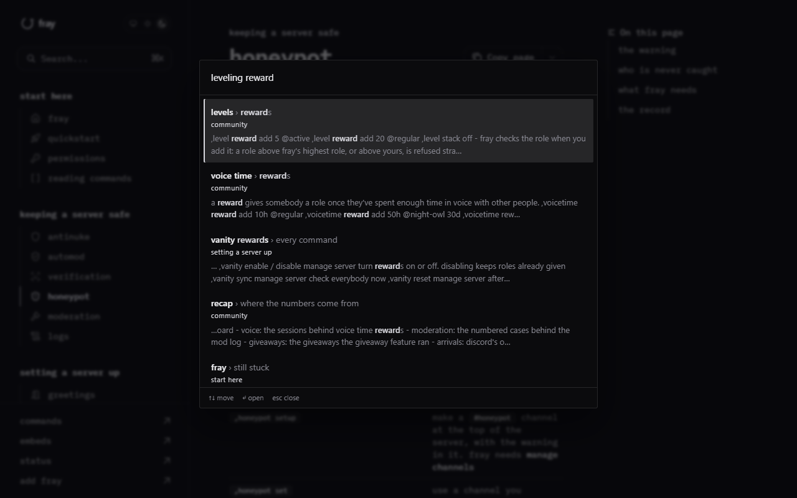

<p align="center"></p>

# mintsearch

Search, a sitemap and `llms.txt` for a self-hosted [Mintlify](https://mintlify.com) export.

`mint export` gives you a static copy of your docs to host anywhere, but its search asks Mintlify's cloud service, so an export that was never signed in shows "run mint login in the cli to activate search" in the search bar. It also links to a `sitemap.xml` and an `llms.txt` it never writes.

mintsearch fixes both in one pass over the exported folder:

- builds a search index from your `.mdx` source and adds a small search overlay to every page. It takes over the search bar and <kbd>ctrl</kbd>+<kbd>k</kbd>, works offline, and needs no account or API key.
- writes `sitemap.xml`, `robots.txt` (only if you don't already have one) and `llms.txt` from your `docs.json` navigation.



It runs on [docs.fray.lol](https://docs.fray.lol).

## install

```bash
pip install git+https://github.com/ashfall-sh/mintsearch
```

Python 3.10 or newer, no dependencies.

## use

```bash
mint export
unzip export.zip -d site
mintsearch site --source . --site https://docs.example.com
```

Then host `site/` as usual. Run it after every export; running it twice over the same folder is safe.

| option | what it does |
| --- | --- |
| `--source DIR` | the folder with `docs.json` and your pages (default: the current folder) |
| `--site URL` | your public address. With it, `sitemap.xml`, `robots.txt` and `llms.txt` are written |
| `--base PATH` | the path the docs are served under, like `/docs`, if not the root |
| `--title`, `--summary` | the heading and summary line of `llms.txt` (default: `name` and `description` in `docs.json`) |
| `--head FILE` | extra html to add to every page, like an analytics tag |

## how it works

The index is built from the source pages rather than the exported html, so each page becomes its title, description, navigation group and one entry per heading, without the theme around them. Every navigation shape in `docs.json` is read: groups, nested groups, tabs, anchors, dropdowns, versions and languages.

Results rank a match in a title above one in a heading, above one in the text. The overlay follows the page's light or dark mode.

Tested with the maple theme. Other themes use the same search bar, so they should work. If one doesn't, please open an issue.

## license

MIT
